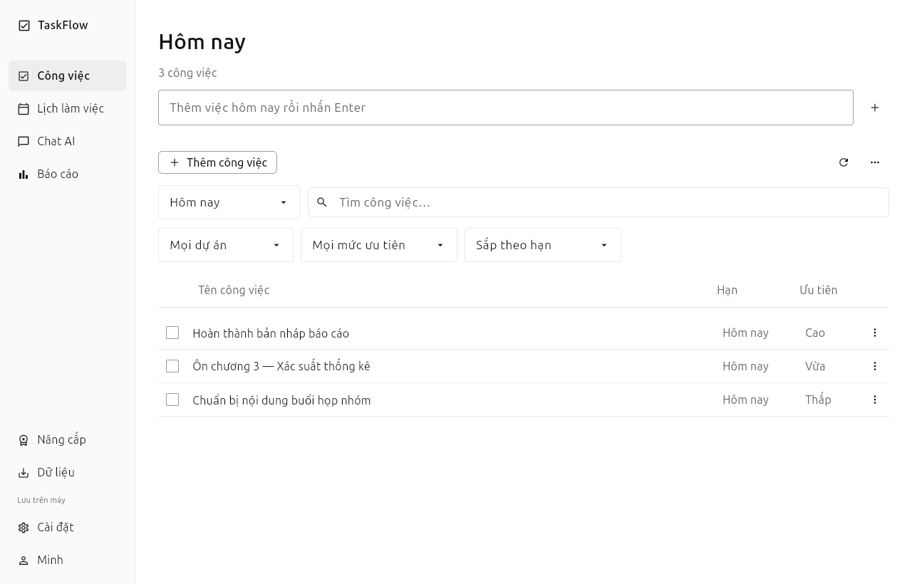
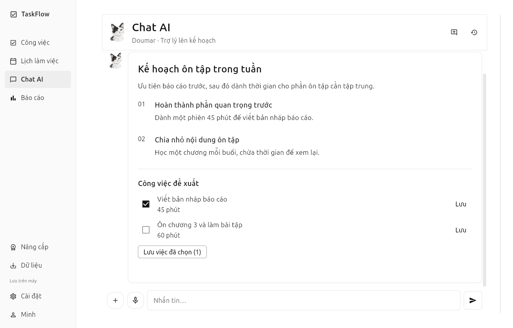

<div align="center">


# TaskFlow

**Công việc rõ ràng. Lịch trình hợp lý. Tập trung vào điều cần làm.**

Ứng dụng desktop dành cho nhân viên và sinh viên: quản lý công việc, sắp xếp lịch, nhắc việc và lập kế hoạch cùng trợ lý Doumar.

**Windows & Linux · Python + Flet · MySQL · Gemini**

[Bắt đầu](#bắt-đầu) · [Tính năng](#tính-năng) · [Các gói](#các-gói) · [Cấu hình máy chủ](docs/SETUP.md)

</div>

---

## Không gian làm việc gọn, dễ đọc

Nền trắng, chữ đen, danh sách công việc dạng dòng và điều hướng cố định. Chat AI là một trang riêng; việc thêm hoặc sửa công việc có màn hình riêng để tập trung vào nội dung.

| Công việc | Chat với Doumar |
|:--:|:--:|
|  |  |

Ảnh chụp từ ứng dụng desktop với nội dung minh họa; không chứa dữ liệu cá nhân.

## Tính năng

| Không gian | Có thể làm gì |
|---|---|
| **Công việc** | Thêm, sửa, xóa, hoàn tác, nhân bản; việc con, nhãn, ưu tiên, hạn hoàn thành và tìm kiếm. |
| **Lịch** | Thêm lịch cố định; xem đề xuất thời gian trước khi áp dụng, tránh lịch đã có và giữ nguyên deadline. |
| **Doumar AI** | Chat, lập kế hoạch có cấu trúc, chọn công việc đề xuất để lưu; hỗ trợ ảnh, tài liệu và giọng nói theo gói. |
| **Báo cáo** | Theo dõi công việc và tiến độ từ dữ liệu thực theo ngày, 7 ngày hoặc 30 ngày. |
| **Nhắc việc** | Nhắc khi app mở hoặc qua tiến trình nền tùy chọn; nhập nhanh từ khay hệ thống. |
| **Tài khoản** | Đồng bộ theo tài khoản, xử lý xung đột, đăng nhập Google/Facebook qua OAuth khi được cấu hình. |
| **Dữ liệu** | Sao lưu/khôi phục JSON, xuất CSV, Thùng rác và phục hồi công việc. |

Các phân tích hành vi phục vụ lập lịch nằm trong lớp xử lý; không làm rối màn hình công việc.

## Bắt đầu

Cần Python và môi trường desktop. Bản hiện tại được kiểm tra trên Linux với Python 3.14, Flet 1.0.5; Windows là nền tảng mục tiêu cần xác nhận thêm trước khi phát hành bộ cài.

### 1. Cài đặt

```bash
git clone https://github.com/chifunedarklord/Doumar.git
cd Doumar
python -m venv .venv
```

Kích hoạt môi trường:

```bash
# Linux
source .venv/bin/activate

# Windows PowerShell
.venv\Scripts\Activate.ps1
```

```bash
python -m pip install -r requirements.txt
```

### 2. Cấu hình desktop

Sao chép `.env.example` thành `.env`, rồi điều chỉnh địa chỉ API nếu dùng đồng bộ. Mặc định dữ liệu cục bộ lưu trong `data/taskflow.db`.

```dotenv
DB_TYPE=sqlite
TASKFLOW_API_URL=https://api.example.com
```

Thay URL bằng API của bạn. Có thể để trống `TASKFLOW_API_URL` để quản lý công việc bằng tài khoản cục bộ. Tài khoản cục bộ không tự nhận quyền Plus/Pro hoặc tự đồng bộ lên máy chủ.

### 3. Mở ứng dụng

```bash
python main.py
```

Để chạy API, MySQL/XAMPP, Google Calendar, OAuth, AI hoặc thanh toán, xem **[hướng dẫn cấu hình và triển khai](docs/SETUP.md)**.

## Các gói

| | Free | Plus | Pro |
|---|---|---|---|
| Công việc, lịch cố định, nhắc việc, sao lưu | ✓ | ✓ | ✓ |
| Dự án, công việc lặp, đề xuất lịch | — | ✓ | ✓ |
| Chat AI và lập kế hoạch | — | ✓ | ✓ |
| Ảnh, tài liệu và giọng nói với AI | — | — | ✓ |
| Báo cáo | 7 ngày | 30 ngày | 30 ngày |
| Hạn mức AI mặc định / tháng UTC | — | 300 lượt | 1.500 lượt |
| Giá mỗi tháng | **Miễn phí** | **149.000đ** | **499.000đ** |
| Tháng đầu cho lần mua đầu tiên | — | **67.000đ** | **399.000đ** |
| Thanh toán một năm | — | **1.430.400đ** | **4.790.400đ** |

Gói năm giảm **20%** trên tổng giá chuẩn 12 tháng; không cộng thêm ưu đãi tháng đầu. Pro mở toàn bộ nhóm chức năng, vẫn áp dụng hạn mức AI. Quyền sử dụng và số tiền được xác nhận ở server; không có tài khoản mẫu hoặc cờ phát triển để tự mở khóa gói.

## Kiến trúc

```text
Desktop Flet ── HTTPS ── API tài khoản / đồng bộ / gói
     │                          │
     └── SQLite cục bộ          ├── MySQL / MariaDB
                                ├── Gemini AI
                                ├── Google / Facebook OAuth
                                ├── Google Calendar + worker
                                └── Stripe / payOS + webhook
```

Desktop giữ dữ liệu để tiếp tục làm việc khi mất mạng. Khóa AI, thông tin merchant và mật khẩu MySQL nằm trên máy chủ. phpMyAdmin chỉ là công cụ quản trị MySQL, không phải API của ứng dụng.

```text
Doumar/
├── main.py                 # Cửa sổ desktop và điều hướng
├── components/             # Thành phần giao diện và theme đen trắng
├── screens/                # Các trang đang được sử dụng
├── core/                   # Dữ liệu, nghiệp vụ, đồng bộ và nhắc việc
├── server/                 # API, OAuth, MySQL, AI và thanh toán
├── scripts/                # Công cụ chuyển dữ liệu máy chủ
├── utils/                  # Xử lý AI và tài liệu
├── assets/                 # Avatar và tài nguyên ứng dụng
└── docs/                   # Hướng dẫn triển khai, ảnh giao diện
```

## Kết nối trước khi mở bán

Mã nguồn có các adapter và luồng tích hợp; dịch vụ bên ngoài cần thông tin của nhà phát hành:

- **Google/Facebook:** App ID, secret, callback và cấu hình công bố ứng dụng.
- **Google Calendar:** Calendar API, OAuth và khóa mã hóa token; chạy worker riêng.
- **Visa/QR:** tài khoản merchant Stripe/payOS và webhook xác thực. Chưa cấu hình thì không tạo đơn hoặc cấp gói giả.
- **Khôi phục mật khẩu:** SMTP trên máy chủ.
- **Phát hành:** hosting HTTPS, sao lưu, kiểm tra bộ cài và nhắc nền trên từng hệ điều hành.

Không đưa `.env`, cơ sở dữ liệu, token hay thông tin khách hàng lên Git. Tích hợp giọng nói cần microphone, quyền hệ điều hành và kết nối mạng phù hợp. Thư viện OCR có thể cần cài Tesseract riêng.

## Tài nguyên và sử dụng

Avatar mèo thủy mặc được tạo riêng cho dự án. Icon chức năng dùng Material; biểu tượng nhà cung cấp phục vụ nhận diện đăng nhập. Dự án hiện chưa kèm giấy phép phân phối mã nguồn; trao đổi với chủ dự án trước khi tái phân phối hoặc sử dụng thương mại.

<div align="center">

**TaskFlow · Doumar**

Ít chi tiết thừa hơn. Nhiều thời gian cho công việc hơn.

</div>
